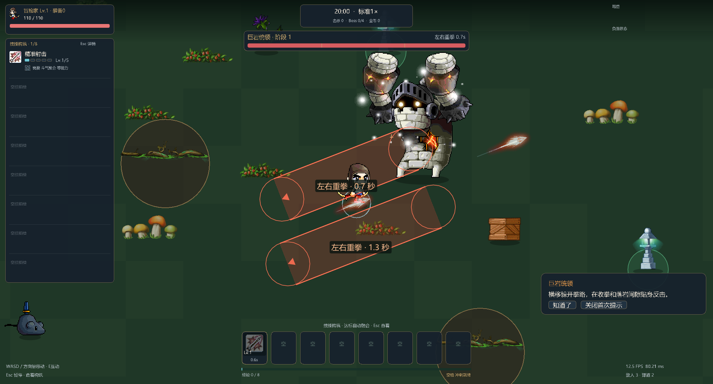
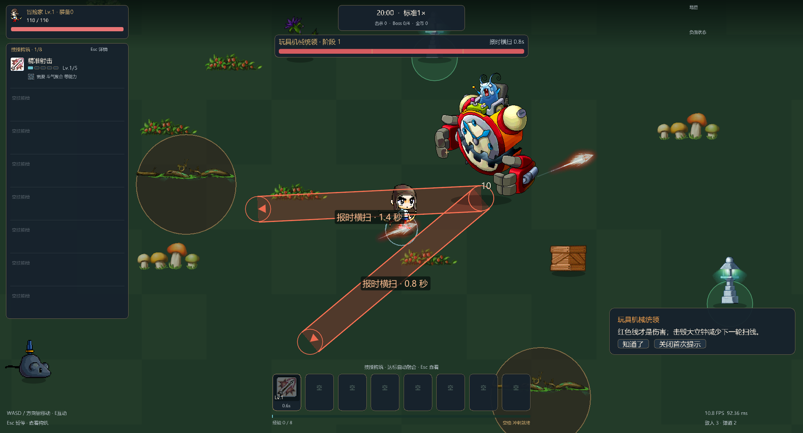
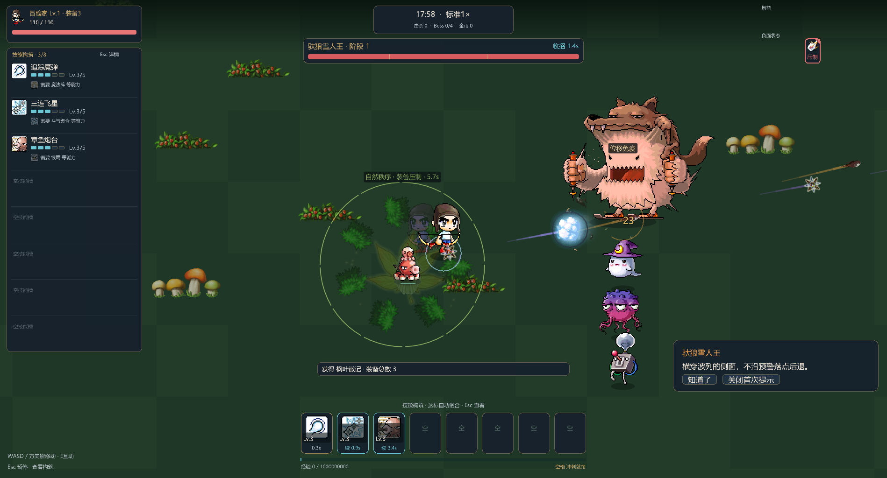
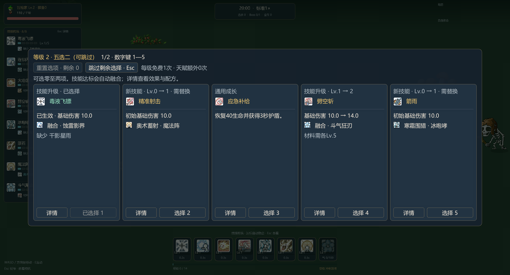

# MapleRGL · 枫林幸存者


一个使用 C++17、Dear ImGui、Win32 / Direct3D 11 制作的 Windows 生存动作小游戏。移动躲避危险，自动攻击，通过技能升级、共鸣和自动融合组成自己的冒险构筑。

游戏离线运行，无需账号或游戏服务器。

## 游戏内容

- **自由构筑**：70种基础技能来自公共池，最多装备8个主动技能；弓、法杖和剑决定起始技能与角色外观。
- **升级五选二**：最多选择两项，也可以不选或只选一项；每次升级一次免费重置，保留已选效果。
- **自动融合**：89种二源、12种三源与8种四源结果。当前材料全部达到真实Lv.5后自动融合，前置融合也需升到Lv.5才能继续进阶。
- **技能共鸣**：20种共鸣由真实攻击、命中、护盾和位移触发，不消耗技能；其中6种可选择强化方向。
- **局内装备**：40种装备拾取即生效，持有数量无上限，不占技能槽；营地还提供永久成长、遗物和出发装备。
- **专属首领战**：24种Boss各有三项招式、阶段组合与核心机制；摧毁节点、绕开锁定路径、利用收招窗口应对战斗。Boss永久免疫外部位移。
- **连续战场**：60种怪物外观，追踪、侧翼、远程、重装与支援分工；随机事件、敌人能力和危险领域继续生效，首领大招期间适当延后新的高压遭遇。
- **两种节奏**：经典标准流程约20分钟，紧凑2×约10分钟有效战斗。倍速影响关卡进程，移动、攻击、冷却和音乐保持正常速度。
- **战斗表现**：原生章鱼等召唤动画、按敌人来源区分的弹道与命中、流动的灰蓝烟幕和半透明钟表力场；高阶融合沿实际路径和区域组织特效。
- **芯片音乐**：8首原创Game Boy风格音乐、14类技能合成音色，设置中可独立调节音乐、战斗音效和提示音。
- **战斗回顾**：首领图鉴记录实际遭遇和观察到的招式；失败复盘展示最近8秒的真实伤害、护盾与关键状态。可关闭短引导，并调整闪光、特效和界面缩放。

还有连续远征、每日挑战、无尽模式、图鉴、成就与冒险记录。完整规则见[玩法说明](docs/GAMEPLAY.md)，搭配路线见[融合图谱](docs/FUSIONS.md)，首领招式与应对见[首领图鉴](docs/BOSSES.md)。

## 游戏画面









以上为 v0.2.0 原生游戏界面的隔离演示场景，展示首领招式、危险领域与升级界面。[技能音色试听](docs/audio/skill-sfx.wav) · [音乐与音效说明](docs/AUDIO.md) · [战场素材说明](docs/BATTLE_ART.md) · [版本验证记录](docs/COMBAT_REVIEW.md)

## 运行

需要 Windows 10/11 x64、支持 Direct3D 11 的显卡，以及系统微软雅黑或黑体。

从 [GitHub Release](https://github.com/PlsGoodBoy/MapleRGL/releases/latest) 下载 Windows x64 压缩包，解压后运行 `MapleRGL.exe`。Release 只保留最新版本及下载附件；源码仍保留正常提交历史。

便携包使用项目根目录 `release/`。双击 `MapleRGL.exe` 启动，保留相邻的 `assets/` 和三个运行库DLL。发布时压缩整个文件夹，不能只复制EXE。

`release/` 为本地生成目录，不随源码提交；克隆仓库后按下方步骤构建。

| 操作 | 按键 / 入口 |
| --- | --- |
| 移动 | WASD 或方向键 |
| 冲刺 | 空格 |
| 场景互动 | E |
| 暂停 / 构筑详情 | Esc 或左侧构筑栏标题 |
| 升级选卡 | 鼠标或数字键1–5 |
| 跳过本次升级 / 剩余选择 | Esc，已选效果保留 |
| 完整技能说明 | 卡片“详情”，或战斗中悬停技能 |
| 共鸣、融合和装备 | 暂停后的对应分页 |
| 音乐试听 | 设置中的曲目列表 |

打开技能详情或替换预览时，Esc先关闭当前面板；升级与暂停不计入有效战斗时间。

## 构建

安装 Visual Studio 2022 的“使用 C++ 的桌面开发”、Windows SDK 和 CMake。第三方依赖已包含在 `third_party/`，构建不需要下载额外包。

双击 `UpdateRelease.cmd`，或在项目根目录运行：

```powershell
powershell -NoProfile -ExecutionPolicy Bypass -File tools/build_release.ps1
```

脚本构建Windows x64 Release，并同步 `release/` 中的EXE、素材、运行库、说明和SHA256。更新前关闭从该目录启动的游戏。

手动构建开发候选：

```powershell
cmake -S . -B build-release -A x64 -DMAPLERGL_STAGE_DIR=bin-release
cmake --build build-release --config Release --target MapleRGL
```

代码结构、定向检查和资源工具见[开发说明](docs/DEVELOPMENT.md)。

## 存档

正式存档位于 `%LOCALAPPDATA%\MapleRGL`，备份和设置位于同一目录。更新发布文件不会覆盖存档。

经典单局关闭程序后不会恢复当前战场；连续远征在完成章节时保存构筑。已有存档中的完成记录和已融合技能继续保留。

v0.2.0 增加首领战绩和设置字段，读取旧档后按现有原子写入与备份机制保存。若回退至旧程序，需要同时恢复升级前的存档副本；旧程序不能写入新版存档。

## Contributors

感谢以下 AI 工具与模型在项目开发与讨论中提供的协助：

- Codex
- Astra
- ChatGPT

## 素材与第三方说明

这是非官方个人项目，与Nexon、Wizet或其他素材权利方没有隶属或背书关系。MapleStory图像、数据和商标归相应权利方所有，仓库公开不代表这些素材已获得再分发授权。来源见[素材说明](assets/README.md)、[来源记录](docs/assets/)及[权利说明](assets/UPSTREAM-ASSET-NOTICE.md)。不包含原始WZ/NX或Windows字体。

音乐与技能音效由本项目合成，没有提取或改编原作BGM。Dear ImGui、stb_image和nlohmann/json保留各自许可，见[第三方说明](tools/release_NOTICES.txt)。项目源码目前未单独指定开源许可证，第三方库许可不自动覆盖整个项目或美术素材。
