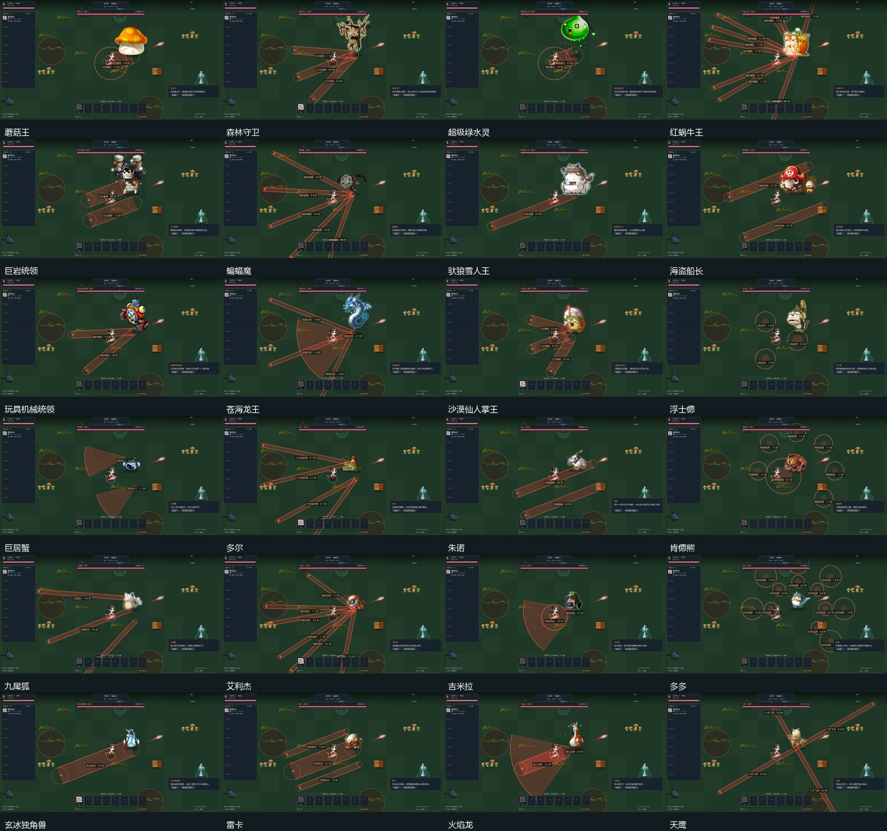

# 首领图鉴与战斗规则

正式遭遇池中的24位首领各有三项招式。下面列出当前实现的核心机制与应对提示，阶段比例指剩余生命占比；战斗内会根据阶段调整招式顺序、落点、弹道数量或节点协同。可在营地图鉴查看真实缩略图、已记录遭遇次数、击败次数和观察过的招式。

## 通用战斗规则

- 预警的圆、扇面和线段与实际命中共用几何参数。落点或冲锋方向锁定后不会暗中跟随玩家；少数追踪弹只在有限窗口内缓慢转向。
- 预警、施招、收招和冷却使用战斗秒，紧凑2×不会缩短躲避时间。首领始终免疫外部位移；击退不会改变其锁定的攻击路线。
- 机制目标使用独立生命，不与本体共享生命。击毁它们能停止对应补射、阻止合流或打开本体破绽；不另发本体击杀、经验与装备奖励。节点有数量和存活时间限制，不要求清除隐藏节点才允许击败首领。
- 阶段转换或本体死亡会取消尚未释放的攻击。已经飞出的独立弹道继续至命中或到期；本体死亡会清理所属机制目标和绑定领域。转换阶段不会重复结算击杀和奖励。
- 首领强招期间允许延后新的非必要高压遭遇，基础怪潮继续，已有敌人不会突然消失。

## 正式首领

| 首领（转阶段生命比例） | 三项招式 | 核心机制 | 应对提示 |
| --- | --- | --- | --- |
| 蘑菇王（68% / 32%） | 王冠重跃、孢子花园、王者滚击 | 孢子仔存活时，滚击落点追加孢子爆发。 | 先清孢子仔；跳跃锁定落点后向侧面移动。 |
| 森林守卫（70% / 35%） | 分叉根须、种子守卫、生长缺环 | 木妖守卫向生长环补射种子；击毁会暴露本体。 | 朝环的缺口离开，靠近木妖可让自动攻击优先处理它。 |
| 超级绿水灵（60% / 28%） | 弹跳重压、水灵喷涌、分裂回流 | 分裂水灵回到本体时提供短时减伤；击毁可阻止合流。 | 水灵回流前拦截，短时减伤结束仍可直接击杀本体。 |
| 红蜗牛王（62% / 30%） | 蜗壳螺旋、黏液折返、背壳棘刺 | 蓄力时正面甲壳减伤，收壳后出现破绽；黏液线会再次脉冲。 | 避开黏液回流线，绕至侧后方输出。 |
| 巨岩统领（72% / 34%） | 左右重拳、断层地裂、落岩围阵 | 两拳依次锁定同一轴线，完整收拳后本体承伤提高。 | 横移躲开拳路，在收拳和落岩间隙贴身反击。 |
| 蝙蝠魔（65% / 25%） | 暗焰扇翼、暗影俯冲、交错暗柱 | 俯冲沿锁定路线执行，身后的暗焰延迟爆发；落地后暴露。 | 先侧移离开影线，再避开留下的暗焰回击。 |
| 驮狼雪人王（66% / 30%） | 巨型滚雪、冰震接力、驮狼踏雪 | 冰震沿已锁定方向逐段推进；踩踏雪痕会再次震动。 | 横穿波列的侧面，不沿预警落点后退。 |
| 海盗船长（70% / 33%） | 舷侧齐射、交错炮列、火药炮组 | 炮组存活时从两翼补射；炮组爆破前可击毁并暴露船长。 | 优先击毁近处炮组，从炮列留白处通过。 |
| 玩具机械统领（75% / 38%） | 报时横扫、滴答连爆、钟摆校时 | 钟摆节点决定下一次扫线数量；报时后的钟域只减慢弹道。 | 红色线才是伤害；击毁大立钟减少下一轮扫线。 |
| 苍海龙王（64% / 29%） | 苍海吐息、潮汐掠冲、水泡涌泉 | 吹泡泡鱼布置额外水柱；节点有限且可击毁。 | 先打掉挡住通道的吹泡泡鱼，再从吐息侧面靠近。 |
| 沙漠仙人掌王（65% / 31%） | 三叉毒刺、沙丘犁地、沙漠花圃 | 花圃存活时向冲锋终点补充毒刺；击毁停止补射。 | 冲锋锁定后侧移，清除靠近自己的食人花。 |
| 浮士德（68% / 32%） | 三角诅咒、幽灵追猎、幽灵仪式 | 追猎弹只在短时间内缓慢转向；幽灵使下一轮追猎增多。 | 诱导弹道转弯后反向走，击毁幽灵减少后续追猎。 |
| 巨居蟹（72% / 35%） | 双钳合门、横步钩击、潮岸蟹群 | 双钳留有中央窄路，青螃蟹从两侧追加钳击。 | 从合门的中缝穿过，绕开正面甲壳。 |
| 多尔（60% / 25%） | 十字追踪弹、扫射阵列、核心过热 | 连续武器循环后核心过热，短时间承受额外伤害。 | 扫射逐列爆发；在过热收招窗口集中输出。 |
| 朱诺（70% / 30%） | 异星栅格、卫兵充能、节点连射 | 外星卫兵是独立能量节点；摧毁后对应连射立即停止。 | 靠近一侧节点打开通路，不必清完全部节点才能打本体。 |
| 肯德熊（67% / 33%） | 熊掌震荡、竹风横扫、踏步靠山 | 熊掌先近后远，靠山锁线并在结束后露出长破绽。 | 不要贴着拳路后退，横移后追击收招。 |
| 九尾狐（62% / 28%） | 九尾狐火、残影扑杀、妖狐幻阵 | 幻灵存活会补射狐火；扑杀的第二击固定延后。 | 别立刻回到旧落点，击毁幻灵削减火力。 |
| 艾利杰（70% / 35%） | 精灵音阶、荆棘花环、花妖守护 | 花妖补射音符；生长环始终保留一个可移动缺口。 | 清除最近的花妖并从花环缺口离开。 |
| 吉米拉（64% / 30%） | 毒息残迹、三重裂爪、超载喷射 | 毒息在锁定落点残留脉冲；喷射后核心短暂暴露。 | 离开毒迹，绕至喷射侧翼等待核心冷却。 |
| 多多（74% / 40%） | 时间涟漪、时间回流、时眼召集 | 时眼存活会补充回流弹；波环缺口在下一阶段错位。 | 先看缺口方向，打掉附近时眼减少弹道交叉。 |
| 玄冰独角兽（66% / 30%） | 玄冰角冲、星霜坠落、霜卫镜阵 | 霜卫存活会在角冲后追加冰线；角冲固定终点。 | 侧移出角冲通道，清理一侧霜卫打开冰线缺口。 |
| 雷卡（68% / 32%） | 月角犁击、月轮震地、月影召唤 | 月影怪猫存活会扩展下一次犁击的侧路攻击。 | 先杀近处怪猫，利用震地环的缺口切换方向。 |
| 火焰龙（70% / 28%） | 熔火龙息、龙翼坠压、双翼焚风 | 龙息只覆盖正面，坠压后暴露；焚风从两翼向外扫。 | 靠近侧后方，坠压结束后集中攻击。 |
| 天鹰（65% / 30%） | 十字飞羽、鹰爪掠空、风眼护卫 | 幼狮护卫补充飞羽，风眼环留有缺口；掠空落地后暴露。 | 先清近处护卫，再沿风眼的缺口移动。 |

## 原生画面

下面记录24位首领的招牌起手。预警中的圆、扇面和线段来自实际攻击参数；这是隔离演示场景，完整交战和正常流程证据见[版本验证记录](COMBAT_REVIEW.md)。

## 素材对应

首领本体和可取得的攻击姿态使用原生素材。原资源没有独立弹道或特效的招式，沿用已有同主题素材映射，不把替代弹道称为原技能完整复刻。攻击发射点、释放时刻与实际动作衔接；危险边界在低特效模式下仍保留。

逐项来源、动作序号、原始释放时刻和是否采用主题替代，见[首领素材对应表](assets/boss_combat_sources.json)；通用召唤、弹道和领域资源见[战斗素材说明](BATTLE_ART.md)。

图鉴的“已观察”来自实际起手记录；旧版本没有记录的遭遇次数不会从击杀数或遇见标记中猜测补齐。以上说明描述规则，不替代发布前的实机验收结果。
