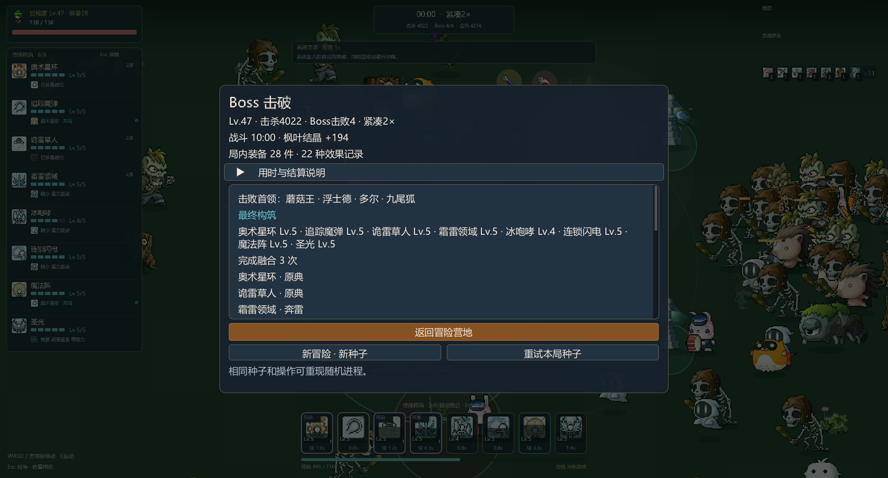

# v0.2.0 验证记录

本版围绕24位正式首领的三项招式、阶段和机制目标，以及敌人协同、自动构筑与战斗反馈进行整理。正式内容清单以[首领图鉴](BOSSES.md)、[玩法说明](GAMEPLAY.md)和[融合图谱](FUSIONS.md)为准。

## 检查范围

| 项目 | 已取得的证据 |
|---|---|
| 正式首领 | 24位均从正常遭遇池生成，逐项观察三招、两次阶段变化、位移免疫、死亡和单次奖励；另保留原生渲染画面 |
| 判定与清理 | 扇面前后方实际扣血检查；森林节点连射、钟表领域在阶段切换时取消；独立已发射弹道按生命周期结束 |
| 敌人协同与设施 | 局部错拍、支援跟随、侧翼路径、局部绕行与失效目标切换；近战、追踪弹、领域、章鱼以及旧融合射击/领域/双召唤均能主动伤害真实祭坛HP，不计为敌人击杀 |
| 自动融合 | Lv.5门槛，多源接续与冲突优先级；第一选融合后第二选读取新状态；材料冷却与封印保留；重复制作不重发首次护盾 |
| 装备与奖励 | 聚合持有、压制中拾取与恢复、158件装备实际JSON往返；机制节点不发本体击杀和装备奖励 |
| 存档 | 原子写入、备份恢复、旧档迁移、重复结算、章节恢复及新设置/首领统计保存 |
| 时钟 | 1×与2×关卡进度、独立战斗秒和终点语义；经典1200进程秒，远征章节保留原时长 |
| 音频 | 合成音频检查；三个原生首领场景均打开音频设备，写入错误为0；不据此声称人工听感验收 |

执行了与本次修改有关的 `adventure_directed`、`enemy_profiles`、`enemy_cooperation`、`pressure_runtime`、`progression_save`、`chapter_save`、`build_save_migration` 和 `chiptune_audio`。存档检查中的三处旧目录数量、旧基础生命和旧格式版本预期已按当前规则修正，其余写入、幂等和构筑完整性约束保留；只补跑受影响的失败项。

## 三场完整首领交战

以下为真实DX11渲染、合法自动输入、预设双技能构筑的隔离场景。首领初始生命3200，玩家使用正常生命，没有无敌，也没有在战斗中改写生命。它们证明完整交战可结束，不代表自然获得该构筑或人工难度评价。

| 首领 / 起始构筑 | 有效战斗秒 | 观察招式 | 阶段变化 | 击毁机制目标 | 结果 |
|---|---:|---:|---:|---:|---|
| 巨岩统领 / 重击、剑气 | 115.85 | 3 | 2 | 0 | 击败 |
| 海盗船长 / 追踪魔弹、箭矢 | 34.67 | 3 | 2 | 4 | 击败 |
| 玩具机械统领 / 区域、符文 | 127.77 | 3 | 2 | 10 | 击败 |

## 三个固定种子的正常流程样本

无界面模拟，只使用合法移动、冲刺、互动、升级和替换。没有修改生命、随机数、构筑或奖励。种子预先固定，没有删除失败样本。

| 种子 | 结果 | 关卡进程秒 | 有效战斗秒 | 击败首领 | 自动融合 | 装备件数 |
|---|---|---:|---:|---:|---:|---:|
| 20261112 | 生存通关 | 1200 | 599.90 | 4 | 5 | 22 |
| 20261113 | 失败 | 179.73 | 89.87 | 0 | 1 | 2 |
| 20261114 | 生存通关 | 1200 | 599.90 | 2 | 4 | 11 |

经典模式当前安排240、552、876、1110进程秒四次首领遭遇；存活首领受并发限制，后续遭遇可能延后。生存通关不等于击败所有首领，因此不能用通关数替代首领击杀数。这三个样本也不足以估计总体胜率。

## 原生完整流程与界面

种子20261112的原生紧凑经典流程完成1200进程秒与600.00有效战斗秒，包含选卡在内用时610.46秒。普通初始生命、无无敌，实际承受128.93伤害；最终Lv.47，92次选择、4次换技、3次自动融合、28件装备，击败蘑菇王、浮士德、多尔和九尾狐。隔离存档中结算历史写入一次，活动单局已关闭。

这是实时DX11绘制配合合法自动输入的流程，既不是人工试玩，也不是无界面快进。后续祭坛主动选敌和局部查询优化按受影响的攻击、协同及首领路径单独复测，未重复整条十分钟流程。

原生ImGui输入流程一次通过10个检查点：数字选卡触发自动融合且保留第二选，Esc跳过，八槽换技选择/取消/确认，点击一次重置保留已选效果，再Esc结束。输入通过现有UI处理，JSON记录了21条按键/鼠标事件及真实控件坐标；只有场景准备使用预设构筑。另检查1280×800的升级、换技和可滚动设置布局。

烟幕、自然秩序、退化使用原生进出区域画面，卸甲与暂停恢复也保留了原生记录；状态压制及恢复的数值约束由相关战斗检查验证。没有把单张截图视为时序正确性的全部证据。

## 性能与资源

对照使用同一台AMD Radeon Graphics机器、DX11硬件后端、1920×1080窗口、相同的召唤/高阶融合/密集场景。两侧分别运行保留的v0.1.1程序和本版候选，记录更新、绘制构建、提交、Present、实体峰值和内存。

宿主环境将窗口报告为 `DXGI_STATUS_OCCLUDED`，截图来自真实DX11回缓冲。记录的CPU绘制耗时可比较，但不包含正常前台垂直同步等待，不能换算或宣传为前台FPS。每场360帧，帧工作统计剔除前120帧预热；调用 `Present(1,0)`，遮挡时另有20ms休眠，休眠未计入表中的工作耗时。

| 场景 / 版本 | 帧工作均值 / P95（ms） | 更新均值（ms） | 绘制构建 / 提交 / Present均值（ms） | 敌人 / 投射物 / 效果峰值 |
|---|---|---:|---|---|
| 多召唤 / 0.1.1 | 1.224 / 1.532 | 0.069 | 0.318 / 0.075 / 0.266 | 11 / 5 / 11 |
| 多召唤 / 0.2.0 | 1.278 / 1.578 | 0.067 | 0.318 / 0.076 / 0.261 | 11 / 6 / 12 |
| 高阶融合 / 0.1.1 | 1.203 / 1.521 | 0.054 | 0.287 / 0.076 / 0.260 | 11 / 5 / 9 |
| 高阶融合 / 0.2.0 | 1.183 / 1.494 | 0.060 | 0.295 / 0.079 / 0.245 | 11 / 5 / 9 |
| 密集怪潮 / 0.1.1 | 2.575 / 5.305 | 0.288 | 0.919 / 0.212 / 0.465 | 500 / 10 / 32 |
| 密集怪潮 / 0.2.0 | 2.079 / 2.735 | 0.247 | 0.818 / 0.180 / 0.381 | 500 / 10 / 27 |

召唤与融合场景耗时接近，密集样本的工作耗时下降；首领和选敌行为改变会改变实际效果数量，因此不把单次采样归因为某一处优化或宣传普遍提升倍率。各样本工作时间最大值为14.8–23.2ms（旧版）、16.1–22.1ms（新版），包含一次回缓冲截图开销。密集场景末尾私有内存474.93→480.28MiB，纹理3314→3334，包含新增原生攻击动画缓存。

完整流程的私有内存从366.80MiB至374.16MiB，最后约两分钟的采样范围373.18–373.96MiB；末尾纹理缓存2101项。观测到的最大模拟步数为每帧8步，最大积压约0.0167秒。此为单次流程的采样趋势，启动预加载和缓存增长不直接视为泄漏。

额外的暗潮压力场景发现了一次真实退化：新增协同移动先收集整片邻居，攻击预算又反复扫描全体敌人。修复仅把协同移动限制为局部样本，并让预算读取当前正在起手或攻击的敌人；伤害查询仍遍历完整范围，刷怪规则和模拟步长不变。相关 `enemy_cooperation`、`enemy_profiles` 两项检查通过后，仅补采一次同配置压力场景，保留了失败候选的数据。

| 暗潮压力版本 | 帧工作均值 / P95（ms） | 更新均值（ms） | 敌人 / 投射物 / 效果峰值 |
|---|---|---:|---|
| 0.1.1 | 6.863 / 10.322 | 1.718 | 1573 / 3 / 42 |
| 0.2.0 修复前候选 | 17.369 / 30.637 | 9.559 | 1599 / 4 / 52 |
| 0.2.0 最终候选 | 6.028 / 7.872 | 1.712 | 1588 / 3 / 34 |

同样采集360帧并剔除120帧预热，最终候选帧工作最大值21.576ms，末尾私有内存462.64MiB、纹理3154项；运行中新增敌人请求147、实际147，没有容量丢弃。三个样本按真实时间推进，实际战斗时长和效果数量会不同；此结果确认已定位的CPU退化得到修复，不用于宣称普遍加速倍率或前台帧率。

## 已知范围与待人工确认

- Windows界面控制工具在初始化时报告内核路径不存在；因此无法执行桌面鼠标、Alt-Tab、最小化恢复的人工式操作。原生ImGui注入验证与操作系统输入路径分开记录。
- 尚未取得正常前台Present帧率和人工音乐听感结论；没有用后台采样替代这些结论。
- 首领本体使用原生素材，缺少对应原始弹道的招式采用明确记录的同主题素材；并非原版全部招式的逐帧复刻。
- 一次完整流程只反映本次实体与内存趋势，不能证明无限时长无泄漏，也不替代所有技能、装备、词缀的全组合试玩。

原始构建日志、隔离存档、逐场JSON和截图保存在本地 `artifacts/boss-combat/`，不进入便携发布目录。正式用户存档未用于验证。
